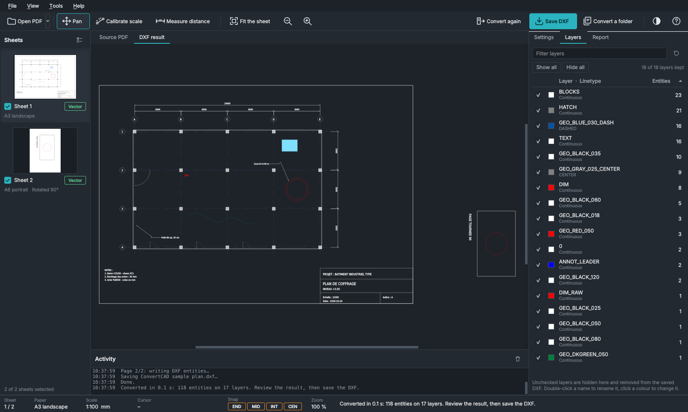
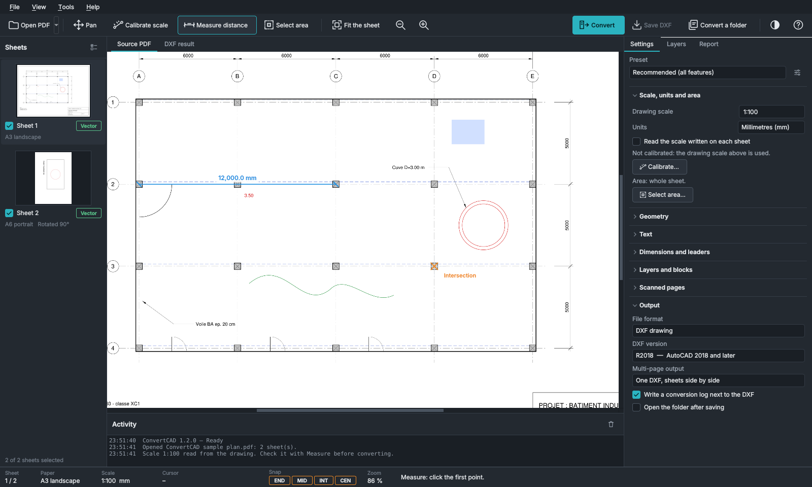
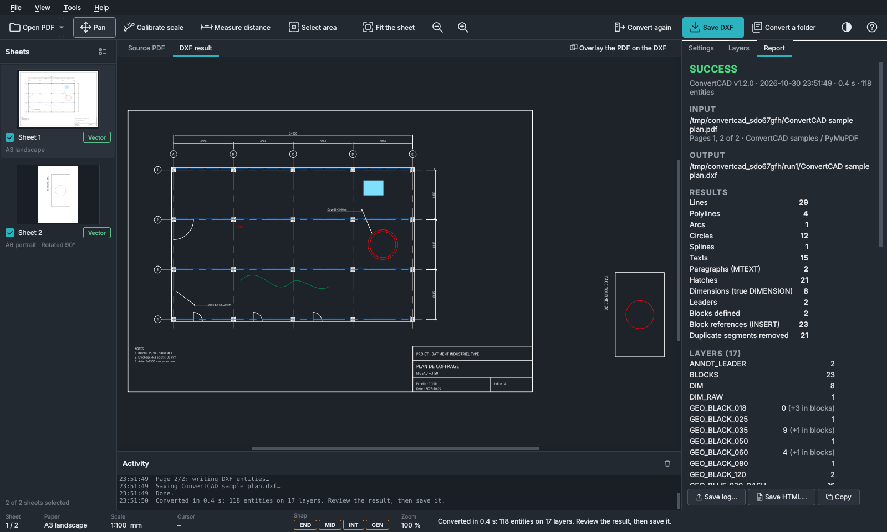
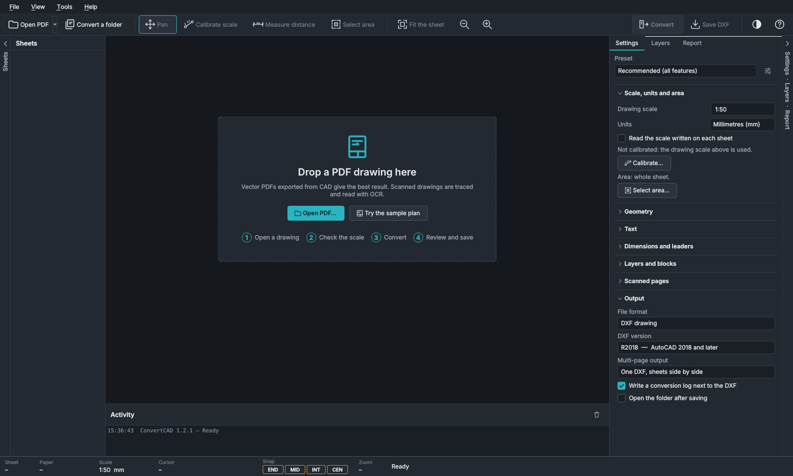
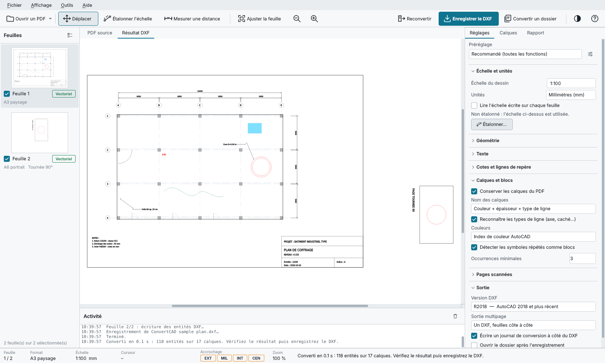

<p align="center">
  
</p>

<h1 align="center">ConvertCAD</h1>

<p align="center">
  <b>Convert 2D PDF drawings into editable DXF and DWG files built with real CAD entities.</b><br>
  Lines, polylines, arcs, circles, splines, hatches, text, <b>true dimensions</b>, <b>leaders</b>,
  <b>layers</b> and <b>blocks</b> — not exploded line spaghetti.<br>
  Windows (portable or installer) · Linux (AppImage, .deb) · conversions 100 % offline · English · Français · Español · Deutsch · العربية
</p>



---

## Why ConvertCAD

Engineering teams receive drawings as PDF all the time: consultant plans, vendor
drawings, archive scans. Re-drawing them by hand is slow and error-prone, and most
converters produce thousands of loose segments that nobody can edit.

ConvertCAD rebuilds the **intent** of the drawing:

| In the PDF | In the DXF / DWG |
|---|---|
| Curves made of Bezier pieces | True **ARC** / **CIRCLE**, or one exact **SPLINE** |
| Touching segments | One **LWPOLYLINE** (closed when it loops) |
| Dash patterns, or dashes drawn as separate pieces | One line with a linetype **CENTER**, **DASHED**, **DASHDOT**, **PHANTOM**… measured on the PDF |
| Arrows + line + value, oblique ticks + line + value | Real **DIMENSION** entities (the PDF value is kept) |
| Arrow on a circle + "R…" / "Ø…"; two arrows on an arc + "45°" or an arc length | Real **RADIUS**, **DIAMETER**, **ANGULAR** and **ARC LENGTH** dimensions |
| Arrow + polyline + note | **MULTILEADER** (classic **LEADER** for older DXF versions) |
| The same symbol repeated (columns, doors, bolts…), even turned by any angle or mirrored | One **BLOCK** + one **INSERT** per occurrence |
| Stacked text lines | One **MTEXT** paragraph |
| Solid fills · hatching drawn as hundreds of parallel lines | **HATCH** (solid · pattern with its angle and spacing) |
| Sand, concrete, gravel, earth, brick, insulation, dots plotted as thousands of dashes and dots | One **HATCH** with the standard AutoCAD pattern (AR-SAND, AR-CONC, GRAVEL, EARTH, BRICK, INSUL, DOTS…) at its measured scale and angle |
| AutoCAD SHX text plotted as strokes | Real **TEXT** with the original string |
| Scanned sheets | Traced lines, circles and arcs + OCR text (PP-OCR, 50+ languages), scan kept on a locked layer |
| Colours, line weights, PDF layers | Organised **layers** (`GEO_BLACK_050_CENTER`, `DIM`, `TEXT`, …) |

**Safe by design:** a dimension is rebuilt only when arrows, line and text all agree (an
angle or an arc length only when its value agrees with the drawn arc); a texture becomes a
standard pattern only when that pattern, drawn again, reproduces the PDF. Measurement
texts that matched nothing go to the red layer `DIM_RAW` for review. Nothing is invented.

## Features

- **Four-step workflow** with one highlighted action at a time: *Open → Check the scale →
  Convert → Review and save*.
- **DXF or DWG** — DXF R12 → R2018, or **native DWG** (AutoCAD 2000 format, opens in every
  AutoCAD since 2000 and every CAD program). The DWG converter (GNU LibreDWG) is included
  and every DWG is read back and checked after writing.
- **Convert only an area** — draw a rectangle on the sheet (*A*): only that part is converted.
- **Overlay check** — the PDF shown under the converted drawing with adjustable
  transparency (*O*): differences are seen at a glance.
- **Scale tools** — scale read from the title block, *Calibrate* on two points of known
  distance, *Measure* any distance, with **object snap** (END / MID / INT / CEN) like AutoCAD.
  Sheets with different scales in one set: *read the scale written on each sheet*.
- **Review before saving** — preview of the DXF as CAD software will read it (click an
  entity to see its type, layer and size), layer table (keep / hide, rename, recolour),
  detailed conversion report with warnings.
- **Full options** — curve precision, text height ratio, MTEXT grouping, arrow and tick
  dimensions, leaders, layer naming modes, AutoCAD Color Index or true colour, block detection threshold,
  OCR languages, accuracy and resolution, one file or one file per sheet,
  6 built-in presets + your own.
- **Scanned drawings** — line, circle and arc tracing (OpenCV) and OCR with PaddleOCR's PP-OCR
  models (whole text lines, small, rotated and vertical text). **Built in:** English, French
  and the other Latin-script languages. **One click away** (*Settings → Scanned pages → OCR
  languages and models…*): Arabic, Cyrillic, Greek, Korean, Devanagari, Thai, Tamil, Telugu
  and a maximum-accuracy model — mixed drawings (French + Arabic…) are read line by line.
  The original scan is kept underneath for checking.
- **Big drawings** — an A0 sheet with 40 000 entities previews smoothly; the window opens
  in about half a second (libraries load in the background).
- **Batch** — convert a whole folder (sub-folders included), each file with its log.
- **Command line** — `ConvertCAD-cli.exe` / `python -m convertcad --cli` for scripts.
- **Portable or installed** — portable zip (no installation, no admin rights, settings and
  OCR models can live next to the program on a USB stick) or a normal installer; no drawing
  is ever sent anywhere (the only network uses: downloading an OCR language, or checking
  for a newer version — off by default — when you ask).
- Dark and light themes, crisp on every display scaling; interface in English, French,
  Spanish, German and Arabic (right to left).

<table>
  <tr>
    <td></td>
    <td></td>
  </tr>
  <tr>
    <td align="center"><sub>Measure / calibrate with object snap</sub></td>
    <td align="center"><sub>Conversion report</sub></td>
  </tr>
  <tr>
    <td></td>
    <td></td>
  </tr>
  <tr>
    <td align="center"><sub>Welcome screen</sub></td>
    <td align="center"><sub>Light theme, French interface</sub></td>
  </tr>
</table>

## Getting started

Download from the **Releases** page of this repository. Every download contains
**everything** — Python, all libraries, the DWG converter and the OCR with its built-in
model (English, French and the other Latin-script languages). Nothing else to install.
Other OCR languages are downloaded from the program when needed, then work offline.

### Windows

| Download | Use |
|---|---|
| `ConvertCAD-<version>-win64-setup.exe` | **Installer**: Start-menu entry, uninstaller, no admin rights needed |
| `ConvertCAD-<version>-win64-portable.zip` | **Portable**: unzip anywhere (Desktop, USB stick…) and run `ConvertCAD\ConvertCAD.exe` |

> Windows SmartScreen may warn about a new program the first time:
> *More info → Run anyway*.

### Linux (x86-64)

| Download | Use |
|---|---|
| `ConvertCAD-<version>-x86_64.AppImage` | One file, any distribution: `chmod +x` it, then run it. `--cli` as first argument runs the command line |
| `convertcad_<version>_amd64.deb` | Debian / Ubuntu / Mint: `sudo apt install ./convertcad_<version>_amd64.deb`, then *ConvertCAD* in the menu or `convertcad` |
| `ConvertCAD-<version>-linux-x86_64.tar.gz` | Portable folder: `./ConvertCAD/ConvertCAD` (needs `sudo apt install libxcb-cursor0`) |

### From the source code (developers)

Requires **Python 3.10 or newer** ([python.org](https://www.python.org/downloads/),
tick *Add python.exe to PATH*).

```bat
git clone https://github.com/abdelhaouari-AE/ConvertCAD.git
cd ConvertCAD
scripts\setup_venv.bat        :: once: creates .venv and installs everything
scripts\run_from_source.bat   :: starts ConvertCAD
```

Linux: `./scripts/setup_venv.sh` then `./scripts/run_from_source.sh`. You can also
double-click **`ConvertCAD.pyw`** (no console window) or run `python main.py`: if libraries
are missing, ConvertCAD lists them and offers to install them. From source, the OCR and
its built-in model come with the Python packages; other OCR languages are downloaded from
the program, as in the downloads.
DWG output needs the converter: Windows uses `vendor\libredwg\win64` (included), Linux
builds it once with `./scripts/build_libredwg.sh linux`.

## Using ConvertCAD

1. **Open a drawing** — *Open PDF…* (Ctrl+O), drag & drop, or *Try the sample plan*.
2. **Check the scale** — read automatically from the title block when possible.
   For an exact result, **Calibrate** (C) on two grid axes; **Measure** (M) to verify.
3. **Convert** (Ctrl+Enter) — runs in the background, cancellable.
4. **Review and save** — check the *DXF result* (*Overlay* shows the PDF underneath), adjust
   the *Layers*, read the *Report*, then **Save DXF…** or **Save DWG…** (Ctrl+S).
   A `<name>_log.txt` is written next to the drawing.

To convert only part of a sheet, use **Select area** (A) before converting.

Engineering checklist after every conversion: measure a known distance in CAD, spot-check
layer `DIM` against the PDF, review layer `DIM_RAW`, read the report warnings.

The complete user guide is in the application (*Help → User guide*, F1) and in
[`convertcad/resources/guide_en.md`](convertcad/resources/guide_en.md)
([version française](convertcad/resources/guide_fr.md)).

### Command line

```bat
ConvertCAD-cli plan.pdf                                   :: -> plan.dxf, scale read on the sheet
ConvertCAD-cli plan.pdf -o out\plan.dxf --scale 100 --units mm
ConvertCAD-cli plan.pdf -o plan.dwg                       :: native DWG (AutoCAD 2000 format)
ConvertCAD-cli plan.pdf --area 20,30,420,290              :: only that rectangle (mm on the sheet)
ConvertCAD-cli plan.pdf --pages 1-3,5 --split-pages --dxf-version R2013
ConvertCAD-cli drawings\ -o dxf\ --recursive --preset structural
ConvertCAD-cli scan.pdf --preset scanned --ocr-lang latin+arabic --json report.json
ConvertCAD-cli --list-presets
ConvertCAD-cli --list-ocr                                 :: OCR languages: installed / to download
ConvertCAD-cli --get-ocr-model arabic latin_max           :: download OCR models
```

From source: `python -m convertcad --cli <same arguments>`. Run with `--help` for every
option. Exit code: `0` all converted, `1` a conversion failed, `2` bad arguments.

## Building the downloads

| Download | Command |
|---|---|
| Windows portable zip | `scripts\build_exe.bat` |
| Windows installer | `scripts\build_installer.bat` (needs [Inno Setup](https://jrsoftware.org/isinfo.php) 6.3+) |
| Linux tar.gz · AppImage · .deb | `./scripts/build_linux.sh` · `./scripts/build_appimage.sh` · `./scripts/build_deb.sh` |

Pushing a tag such as `v1.2.0` builds **all five** on GitHub Actions and attaches them to
the release ([`.github/workflows/build.yml`](.github/workflows/build.yml)). The downloadable
OCR models are published once, as the release `ocr-models-v1`, by the workflow
*OCR models release*. Details, code signing and the release checklist:
**[docs/PACKAGING.md](docs/PACKAGING.md)**.

## For developers

- **Language:** Python 3.10+ · **Interface:** PySide6 (Qt 6) · **PDF:** PyMuPDF ·
  **DXF:** ezdxf · **DWG:** GNU LibreDWG · **Scans:** OpenCV + RapidOCR (PP-OCR models,
  ONNX Runtime) · **Tests:** pytest · **Lint:** Ruff · **Packaging:** PyInstaller, Inno Setup,
  AppImage, dpkg · **CI:** GitHub Actions
- Open the folder in **VS Code**: recommended extensions, run/debug configurations
  (application, CLI, tests) and tasks are included in [`.vscode/`](.vscode).
- Run the tests: `python -m pytest -q` · lint: `python -m ruff check .`

```
ConvertCAD/
├── main.py                 application launcher (also the .exe entry point)
├── ConvertCAD.pyw          same, without console window (double-click)
├── convertcad_cli.py       console launcher (ConvertCAD-cli.exe)
├── convertcad/
│   ├── core/               conversion engine — pure Python, never imports Qt
│   ├── ui/                 desktop interface (PySide6)
│   ├── resources/          user guide, terms, OCR help (EN / FR)
│   ├── cli.py · config.py · i18n.py · samples.py
├── tests/                  pytest suite (engine, CLI, jobs, i18n, interface)
├── scripts/                setup / run / build scripts, icon and sample generators
├── installer/              Inno Setup script (Windows installer)
├── packaging/linux/        desktop entry and AppImage launcher
├── vendor/libredwg/        DWG converter: source, patches, Windows programs
├── docs/                   DEVELOPMENT.md, PACKAGING.md, screenshots
├── assets/                 application icon (svg, png, ico)
├── samples/                demonstration PDFs (vector plan + scan)
└── ConvertCAD.spec         PyInstaller recipe
```

📘 **[docs/DEVELOPMENT.md](docs/DEVELOPMENT.md)** describes the whole development: tools and
libraries, architecture and data flow, the content of every file, the algorithms, the
options reference, testing, building, releasing and how to extend the application.
Version history: [CHANGELOG.md](CHANGELOG.md).

## En bref (français)

ConvertCAD convertit des plans PDF 2D en fichiers DXF ou **DWG** modifiables construits avec
de vraies entités CAO : arcs et cercles, polylignes, splines, hachures (pleines, à motif, et
textures — sable, béton, gravier, terre, brique, isolant — rendues au motif AutoCAD
standard), textes et paragraphes, **vraies cotes** (linéaires, rayon, diamètre, angle,
longueur d'arc), **lignes de repère**, **calques** et **blocs** (copies tournées de tout
angle). Windows (installateur ou version portable sans installation) et Linux (AppImage,
.deb), conversions 100 % hors ligne, interface en français, anglais, espagnol, allemand et
arabe (*Affichage → Langue*). Conversion d'une zone choisie, contrôle par superposition du
PDF, sélection d'une entité dans le résultat. Les plans scannés sont vectorisés (lignes,
cercles, arcs) et lus par OCR (modèles PP-OCR : anglais, français et autres langues latines
intégrés ; arabe, cyrillique, grec… téléchargeables en un clic depuis *Réglages → Pages
scannées → Langues et modèles OCR…*). Après chaque conversion,
vérifiez l'échelle sur une cote connue, contrôlez le calque `DIM` et passez en revue le
calque `DIM_RAW`. Guide complet : *Aide → Guide d'utilisation* ou
[`guide_fr.md`](convertcad/resources/guide_fr.md).

## Licence

Copyright © 2026 **abdelhaouari**.

ConvertCAD is free software released under the **GNU Affero General Public License v3.0**
([LICENSE](LICENSE)). This licence was chosen because ConvertCAD is built on
[PyMuPDF](https://pymupdf.readthedocs.io/), which is available under the AGPL-3.0 or a
commercial licence from Artifex. Distributing ConvertCAD in a closed-source / proprietary
form requires a PyMuPDF commercial licence. The licences of all components are listed in
[THIRD_PARTY_NOTICES.md](THIRD_PARTY_NOTICES.md).

ConvertCAD is a drafting aid, not an engineering authority: always verify converted drawings
(scale, dimensions, traced content) before any construction, fabrication or contractual use.
